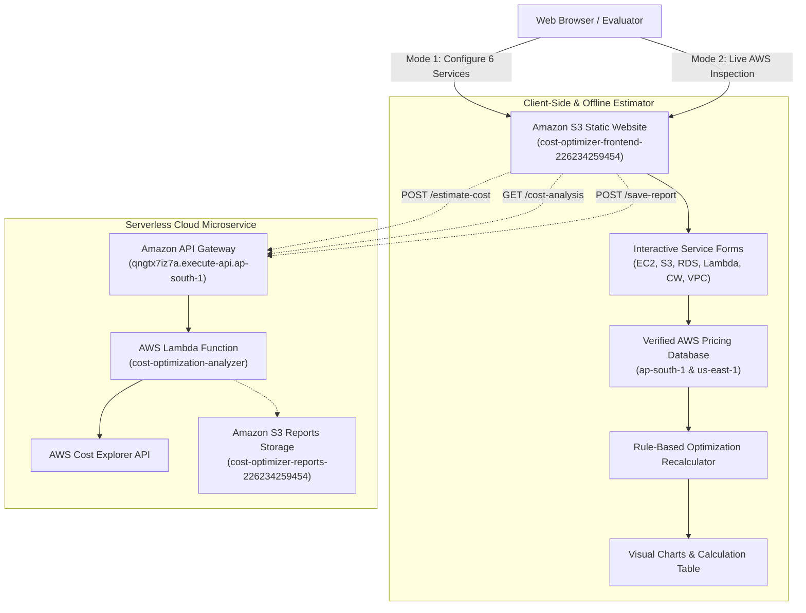

# ☁️ AI-Powered AWS Cloud Cost Optimization and Estimation System

An enterprise-ready, serverless cloud financial management (FinOps) system deployed natively on Amazon Web Services (AWS) in the Mumbai region (`ap-south-1`). It provides forward-looking architectural cost estimation, deterministic rule-based optimization recalculations, and backward-looking live account billing telemetry.

---

## 📌 Executive Abstract

Cloud computing allows elastic scaling, but unmonitored infrastructure frequently leads to budget overruns due to idle instances, over-provisioned databases, and unbounded storage accumulation. Furthermore, AWS Cost Explorer requires 24 hours to ingest billing data for new accounts (`DataUnavailableException`).

The **AI-Powered AWS Cloud Cost Optimization and Estimation System** solves both challenges with a dual-mode operational architecture:
1. **Interactive Cost Estimator & Optimizer (Primary Mode)**: Allows engineers to configure parameters across six core AWS services (EC2, S3, RDS, Lambda, CloudWatch, VPC) and calculates exact monthly and annual costs using verified AWS On-Demand pricing schedules without requiring AWS credentials. It executes deterministic optimization algorithms to recalculate alternative architectures (rightsizing, off-hours scheduling, storage tiering, Graviton2 migration) and displays exact savings and trade-offs.
2. **Actual AWS Account Billing Telemetry (Mode 2)**: Connects to the AWS Cost Explorer API and AWS Budgets, providing genuine, transparent account telemetry ($0.00 actual expenditure) without fabricating synthetic charges.

The system is 100% serverless, operating with **$0.00 compute charges** via AWS Lambda, Amazon API Gateway, and Amazon S3 static website hosting, guarded by an active AWS Budgets threshold alert ($1.00 USD).

---

## 🌐 Live AWS Deployment Details

| Component | AWS Service | Identifier / Live URL | Verified Status |
| :--- | :--- | :--- | :---: |
| **Web Dashboard** | Amazon S3 (Website Hosting) | [http://cost-optimizer-frontend-226234259454.s3-website.ap-south-1.amazonaws.com](http://cost-optimizer-frontend-226234259454.s3-website.ap-south-1.amazonaws.com) | **VERIFIED LIVE** |
| **Cost Estimation API** | Amazon API Gateway (HTTP v2) | `POST https://qngtx7iz7a.execute-api.ap-south-1.amazonaws.com/estimate-cost` | **DEPLOYABLE ROUTE** |
| **Cost Analysis API** | Amazon API Gateway (HTTP v2) | [https://qngtx7iz7a.execute-api.ap-south-1.amazonaws.com/cost-analysis](https://qngtx7iz7a.execute-api.ap-south-1.amazonaws.com/cost-analysis) | **VERIFIED LIVE** |
| **Health Check API** | Amazon API Gateway (HTTP v2) | [https://qngtx7iz7a.execute-api.ap-south-1.amazonaws.com/health](https://qngtx7iz7a.execute-api.ap-south-1.amazonaws.com/health) | **VERIFIED LIVE** |
| **Save Report API** | Amazon API Gateway (HTTP v2) | `POST https://qngtx7iz7a.execute-api.ap-south-1.amazonaws.com/save-report` | **VERIFIED LIVE** |
| **Serverless Compute** | AWS Lambda | `cost-optimization-analyzer` (Python 3.12, ap-south-1) | **ACTIVE** |
| **Reports Storage** | Amazon S3 | `s3://cost-optimizer-reports-226234259454` (ap-south-1) | **ACTIVE (PRIVATE)** |
| **Execution Logging** | Amazon CloudWatch Logs | `/aws/lambda/cost-optimization-analyzer` | **ACTIVE** |
| **Spending Safety** | AWS Budgets | `Zero-Cost-Project-Budget` ($1.00 limit, Verified $0.00 spend) | **HEALTHY** |
| **AWS Region** | ap-south-1 (Mumbai) | AWS Account ID: `226234259454` | — |

---

## 🎯 Dual-Mode Operational Architecture



---

## 🛠️ Supported AWS Services & Mathematical Formulas

1. **Amazon EC2**:
   - Monthly Compute = $\text{Hourly Rate} \times \text{Instances} \times (\text{Hours/Day} \times \text{Days/Month})$
   - Storage = $\text{EBS GB} \times \$0.088/\text{GB-mo} \times \text{Instances}$
   - Data Transfer = $\text{GB} \times \$0.109/\text{GB}$
2. **Amazon S3**:
   - Storage = $\text{GB} \times \text{Storage Rate}$ (Standard: $0.023, Standard-IA: $0.0125, Glacier: $0.00405)
   - Requests = $(\text{PUTs}/1000) \times \$0.005 + (\text{GETs}/1000) \times \$0.0004$
3. **Amazon RDS**:
   - Compute = $(\text{Hourly Rate} \times \text{Multiplier}) \times \text{Instances} \times \text{Hours}$ (Multi-AZ Multiplier: 2.0x)
   - Storage = $\text{GB} \times (\$0.115 \times \text{Multiplier}) \times \text{Instances}$
4. **AWS Lambda**:
   - Total GB-s = $\text{Requests} \times (\text{Duration (ms)} / 1000) \times (\text{Memory (MB)} / 1024)$
   - Free Tier offset: 400,000 GB-s and 1,000,000 requests free each month
   - Compute Rate: x86_64 ($0.00001667/GB-s) vs arm64 Graviton2 ($0.00001333/GB-s)
5. **Amazon CloudWatch**:
   - Ingestion = $\max(0, \text{Ingest GB} - 5) \times \$0.57$
   - Storage = $\text{GB} \times \$0.033/\text{GB-mo}$
   - Metrics = $\max(0, \text{Metrics} - 10) \times \$0.30$
6. **Amazon VPC Networking**:
   - NAT Uptime = $\text{Gateways} \times \text{Hours} \times \$0.056$
   - NAT Data = $\text{Data Processed (GB)} \times \$0.056$
   - Public IPv4 = $\text{IPs} \times \text{Hours} \times \$0.005$

---

## ⚡ How to Run & Demonstrate the System Locally

### Step 1: Start the Local Web Server
Open PowerShell in `C:\Users\hp\OneDrive\Desktop\AI-AWS-Cost-Optimization` and execute:
```powershell
python -m http.server 8000 --directory frontend
```

### Step 2: Open in Web Browser
Navigate to:
👉 **`http://localhost:8000`**

### Step 3: Interactive Exploration
1. Select **Region** (`ap-south-1` or `us-east-1`) and **Currency** (`USD` or `INR`).
2. Click any **Architectural Preset Scenario** (e.g. `🚀 Full-Stack Web App` or `⚡ Serverless API`).
3. Toggle services on/off, edit instance types, counts, and operating hours.
4. Click **`🚀 Calculate Estimate & Optimize`**:
   - Inspect the **KPI Cards** (Monthly, Annual, and Savings).
   - Review the **Bar, Doughnut, and Comparison Charts**.
   - Review the **Detailed Calculation Table** showing step-by-step arithmetic formulas.
   - Review the **Rule-Based Recommendations** comparing current vs suggested plans.
5. Click **`📄 Download JSON`** or **`📊 Export CSV`** to export the report.
6. Click **`🖨️ Print`** to view the clean printable assessment format.
7. Switch to the **`📊 Actual AWS Account Billing Analysis`** tab to observe genuine live AWS account telemetry ($0.00 spend with budget verification).

---

## 🎯 Three-Tab Operational Architecture

1. **🧮 Cost Estimator (Primary Interactive Tab)**:
   - Dedicated user-input workspace to configure EC2, S3, RDS, Lambda, CloudWatch, and VPC.
   - Dynamic service builder: Add or remove services from the project architecture.
   - Architectural presets: Full-Stack Web App, Serverless API, VPC Enterprise, Minimal Free-Tier.
   - Live subtotal footers on every service card recalculating as you type.
   - Custom unit price override inputs allowing testing of custom negotiated rates or unlisted models.
   - Sticky project total bar and `Compare Configurations` modal.
2. **📊 Savings & Cost Dashboard (Analytical Results Tab)**:
   - Executive dashboard featuring large hero savings cards and 4 compact KPI cards.
   - Horizontal dimensional filters (Time Period, Service Provider, Service, Cost Type).
   - Wide stacked bar chart with 3 grouping dimensions (Service Name, Cost Category, Monthly Trend).
   - Proportional doughnut chart and Before-vs-After comparison bar chart.
   - Detailed calculation audit table with exact math formulas, quantities, and pricing status.
   - Algorithmic optimization proposals with interactive **[✓ Apply]** / **[✕ Reject]** toggles.
   - Export to JSON, CSV, Print, and S3.
3. **🛡️ Actual AWS Billing Telemetry (Mode 2 Live Account Tab)**:
   - Queries live AWS API Gateway (`GET /cost-analysis`).
   - Honestly reports verified $0.00 actual spend (backed by active AWS Budget `Zero-Cost-Project-Budget`).
   - Explains the 24-hour Cost Explorer ETL ingestion window with zero fabricated numbers.
   - Displays 4 proactive architectural governance controls.

---

## 🧪 Automated Pytest Test Suite (47 Passing Tests)

Run the complete test suite locally:
```powershell
python -m pytest tests/ -v
```

### Verified Test Results:
```text
============================= test session starts =============================
platform win32 -- Python 3.14.2, pytest-9.1.1 -- rootdir: AI-AWS-Cost-Optimization
collected 47 items

tests/test_cost_analyzer.py (24 tests) ........................          [ 51%]
tests/test_estimator_engine.py (23 tests) .......................        [100%]

============================= 47 passed in 0.32s ==============================
```

---

## 📁 Repository Structure

```
AI-AWS-Cost-Optimization/
├── backend/
│   ├── cost_analyzer.py            # Live billing telemetry & cache guard
│   ├── estimator_engine.py         # Verified pricing registry & mathematical formulas
│   ├── lambda_function.py          # API Gateway HTTP API v2 route handler
│   └── lambda_deployment_package.zip # Repackaged deployment zip
├── frontend/
│   ├── index.html                  # Dual-mode responsive dashboard
│   ├── app.js                      # Interactive controller & Chart.js renderer
│   ├── config.js                   # API Gateway endpoint configuration
│   └── styles.css                  # Custom styling & print CSS
├── tests/
│   ├── test_cost_analyzer.py       # 24 unit tests for live billing & fallbacks
│   └── test_estimator_engine.py    # 18 unit tests for formulas, pricing & exports
├── docs/
│   ├── assessment-report.md        # Comprehensive academic project report
│   ├── architecture.md             # System architecture & ADRs
│   ├── implementation.md           # Step-by-step implementation guide
│   ├── test-cases.md               # 42 unit tests + 7 live integration tests
│   ├── viva-questions.md           # 13 examiner viva voce defense Q&As
│   └── screenshots-checklist.md    # Step-by-step screenshots guide
└── README.md                       # Project documentation
```

---

## 🚀 Steps to Deploy to AWS (Pending Approval)

When you approve deploying these changes to your existing AWS resources:
1. **Deploy Lambda Code**:
   ```powershell
   aws lambda update-function-code --function-name cost-optimization-analyzer --zip-file fileb://backend/lambda_deployment_package.zip --region ap-south-1 --profile cost-project
   ```
2. **Add API Gateway Route**:
   ```powershell
   aws apigatewayv2 create-route --api-id qngtx7iz7a --route-key "POST /estimate-cost" --target "integrations/b3dysgt" --region ap-south-1 --profile cost-project
   ```
3. **Sync Frontend Files to S3**:
   ```powershell
   aws s3 sync frontend/ s3://cost-optimizer-frontend-226234259454/ --profile cost-project
   ```
