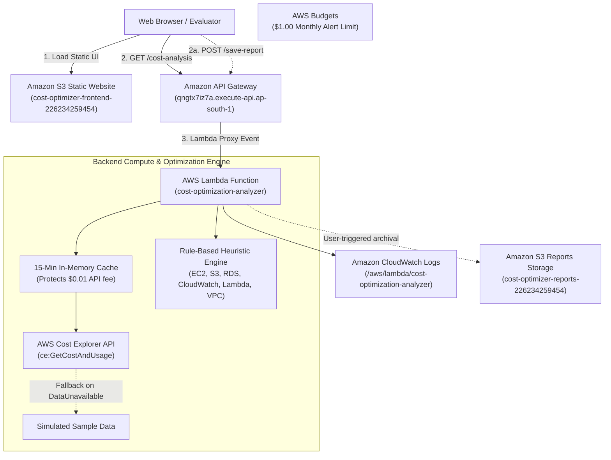

# ☁️ AI-Powered AWS Cloud Cost Optimization System

An enterprise-ready, serverless cloud financial management (FinOps) system deployed natively on Amazon Web Services (AWS) in the Mumbai region (`ap-south-1`). It monitors, analyzes, and provides transparent rule-based optimization intelligence for cloud expenditures.

---

## 📌 Executive Abstract

Cloud computing allows elastic scaling, but unmonitored infrastructure frequently leads to budget overruns due to idle instances, over-provisioned databases, and unbounded storage accumulation. The **AI-Powered AWS Cloud Cost Optimization System** automates the ingestion of AWS billing data through the **AWS Cost Explorer API**, isolates primary cost drivers, formulates actionable rule-based optimization guidance, and estimates potential savings ranges.

The system is 100% serverless, operating with **$0.00 ongoing compute costs** via AWS Lambda, Amazon API Gateway, and Amazon S3 static website hosting, guarded by an active AWS Budgets threshold alert.

---

## 🌐 Live AWS Deployment Details

| Component | AWS Service | Identifier / Live URL | Verified Status |
| :--- | :--- | :--- | :---: |
| **Web Dashboard** | Amazon S3 (Website Hosting) | [http://cost-optimizer-frontend-226234259454.s3-website.ap-south-1.amazonaws.com](http://cost-optimizer-frontend-226234259454.s3-website.ap-south-1.amazonaws.com) | **VERIFIED LIVE** |
| **Cost Analysis API** | Amazon API Gateway (HTTP v2) | [https://qngtx7iz7a.execute-api.ap-south-1.amazonaws.com/cost-analysis](https://qngtx7iz7a.execute-api.ap-south-1.amazonaws.com/cost-analysis) | **VERIFIED LIVE** |
| **Health Check API** | Amazon API Gateway (HTTP v2) | [https://qngtx7iz7a.execute-api.ap-south-1.amazonaws.com/health](https://qngtx7iz7a.execute-api.ap-south-1.amazonaws.com/health) | **VERIFIED LIVE** |
| **Save Report API** | Amazon API Gateway (HTTP v2) | `POST https://qngtx7iz7a.execute-api.ap-south-1.amazonaws.com/save-report` | **VERIFIED ROUTE** |
| **Serverless Compute** | AWS Lambda | `cost-optimization-analyzer` (Python 3.12, ap-south-1) | **ACTIVE** |
| **Reports Storage** | Amazon S3 | `s3://cost-optimizer-reports-226234259454` (ap-south-1) | **ACTIVE** |
| **Execution Logging** | Amazon CloudWatch Logs | `/aws/lambda/cost-optimization-analyzer` | **ACTIVE** |
| **Spending Safety** | AWS Budgets | `Zero-Cost-Project-Budget` ($1.00 limit, Verified $0.00 spend) | **HEALTHY** |
| **AWS Region** | ap-south-1 (Mumbai) | AWS Account ID: `226234259454` | — |

---

## 🎯 Problem Statement & Objectives

### Problem Statement
Modern engineering teams deploy diverse cloud resources across compute, storage, and databases. Without continuous cost governance, companies incur substantial waste. AWS billing consoles are complex and reactive, providing bill shock only after costs have already accumulated.

### Objectives
1. **Automated Billing Retrieval**: Connect programmatically to AWS Cost Explorer via `boto3`.
2. **Transparent Heuristic Intelligence**: Evaluate deterministic heuristic rules across EC2, RDS, S3, CloudWatch, Lambda, and VPC with explainable savings estimations.
3. **Data Source Transparency**: Handle `DataUnavailableException` gracefully and explicitly label whether figures are live or simulated demo data.
4. **Serverless UI**: Host a zero-server interactive web dashboard on Amazon S3 with Chart.js visualizations.
5. **Cost Safety**: Enforce an automated spending budget alert ($1.00 USD) and caching to eliminate unexpected cloud charges.

---

## 🏗️ System Architecture



---

## 📁 Repository Structure

```
AI-AWS-Cost-Optimization/
│
├── app.py                      # Original Streamlit prototype (preserved)
├── requirements.txt            # Local Python dependencies (boto3, pytest)
├── README.md                   # Complete project documentation & assessment guide
│
├── backend/
│   ├── cost_analyzer.py        # Core cost analysis, heuristics, S3 save & fallback logic
│   ├── lambda_function.py      # AWS Lambda entry point with API Gateway CORS
│   └── lambda_deployment_package.zip  # Ready-to-deploy Lambda zip archive
│
├── frontend/
│   ├── index.html              # Responsive web dashboard with JSON/CSV/S3 buttons
│   ├── app.js                  # Frontend controller & Chart.js renderer
│   ├── styles.css              # Custom card styling and animations
│   └── config.js               # API Gateway endpoint configuration
│
├── iam/
│   ├── deployment-policy.json  # Scoped deployment policy for project IAM user
│   ├── lambda-trust-policy.json# IAM assume-role policy for Lambda
│   ├── lambda-execution-policy.json # CloudWatch + Cost Explorer runtime permissions
│   └── s3-website-policy.json  # Public read policy for static website hosting
│
├── tests/
│   └── test_cost_analyzer.py   # 24 automated unit tests with mocked AWS APIs
│
├── docs/
│   ├── architecture.md         # Detailed architectural design & verified resources
│   ├── implementation.md       # Step-by-step technical implementation guide
│   ├── test-cases.md           # 24 unit test cases + live integration test matrix
│   ├── assessment-report.md    # Formal college project report template
│   ├── viva-questions.md       # Comprehensive viva voce preparation guide
│   └── screenshots-checklist.md# Exact screenshots guide for report submission
│
└── backup/
    └── app.py.bak              # Verified backup of initial local prototype
```

---

## 🧪 Local Testing & Verification

All AWS API calls are mocked using `unittest.mock`. Running tests locally incurs **zero AWS charges** and requires no active AWS connection.

### Run Unit Tests in Windows PowerShell:
```powershell
python -m pytest tests/test_cost_analyzer.py -v
```

### Verified Test Results:
```text
============================= test session starts =============================
platform win32 -- Python 3.14.2, pytest-9.1.1 -- rootdir: C:\Users\hp\OneDrive\Desktop\AI-AWS-Cost-Optimization
collected 24 items

tests/test_cost_analyzer.py::test_total_cost_calculation PASSED          [  4%]
tests/test_cost_analyzer.py::test_service_wise_cost_breakdown PASSED     [  8%]
tests/test_cost_analyzer.py::test_highest_cost_service_identification PASSED [ 12%]
tests/test_cost_analyzer.py::test_savings_estimates_and_notice PASSED    [ 16%]
tests/test_cost_analyzer.py::test_retrieval_timestamp_and_metadata PASSED [ 20%]
tests/test_cost_analyzer.py::test_ec2_recommendation_rules PASSED        [ 25%]
tests/test_cost_analyzer.py::test_rds_recommendation_rules PASSED        [ 29%]
tests/test_cost_analyzer.py::test_s3_recommendation_rules PASSED         [ 33%]
tests/test_cost_analyzer.py::test_cloudwatch_recommendation_rules PASSED [ 37%]
tests/test_cost_analyzer.py::test_lambda_recommendation_rules PASSED     [ 41%]
tests/test_cost_analyzer.py::test_data_unavailable_exception_fallback PASSED [ 45%]
tests/test_cost_analyzer.py::test_access_denied_exception_fallback PASSED [ 50%]
tests/test_cost_analyzer.py::test_empty_results_fallback PASSED          [ 54%]
tests/test_cost_analyzer.py::test_live_aws_data_success PASSED           [ 58%]
tests/test_cost_analyzer.py::test_in_memory_cache_prevents_api_charges PASSED [ 62%]
tests/test_cost_analyzer.py::test_save_report_to_s3_success PASSED       [ 66%]
tests/test_cost_analyzer.py::test_save_report_to_s3_permission_failure PASSED [ 70%]
tests/test_cost_analyzer.py::test_lambda_handler_options_preflight PASSED [ 75%]
tests/test_cost_analyzer.py::test_lambda_handler_health_endpoint PASSED  [ 79%]
tests/test_cost_analyzer.py::test_lambda_handler_cost_analysis_demo_mode PASSED [ 83%]
tests/test_cost_analyzer.py::test_lambda_handler_save_report_route_success PASSED [ 87%]
tests/test_cost_analyzer.py::test_lambda_handler_save_report_route_failure PASSED [ 91%]
tests/test_cost_analyzer.py::test_json_download_metadata_structure PASSED [ 95%]
tests/test_cost_analyzer.py::test_date_range_helper PASSED               [100%]

============================= 24 passed in 0.51s ==============================
```

---

## ⚡ How to Run & Demonstrate the System

### 1. View Web Dashboard
Open the public URL directly in any web browser:  
👉 **[http://cost-optimizer-frontend-226234259454.s3-website.ap-south-1.amazonaws.com](http://cost-optimizer-frontend-226234259454.s3-website.ap-south-1.amazonaws.com)**

### 2. Generate Reports
- Click **"📄 Download JSON"** to download `aws_cost_analysis_report_<date>.json`.
- Click **"📊 Export CSV"** to download `aws_cost_analysis_<date>.csv`.
- Click **"💾 Save to S3"** to trigger serverless archival to `cost-optimizer-reports-226234259454`.

### 3. Test API Gateway Endpoints via PowerShell
```powershell
# Query Cost Analysis
Invoke-RestMethod -Uri "https://qngtx7iz7a.execute-api.ap-south-1.amazonaws.com/cost-analysis"

# Query Health Status
Invoke-RestMethod -Uri "https://qngtx7iz7a.execute-api.ap-south-1.amazonaws.com/health"
```

---

## ⚠️ Limitations & Future Work

1. **Cost Explorer 24h Ingestion Latency**: Real AWS Cost Explorer data takes 24 hours after account creation to appear. The system gracefully provides labeled sample data in the interim.
2. **Conditional Rightsizing**: Instance rightsizing suggestions are conditional heuristics based on spending share. Future enhancements will integrate the CloudWatch Agent for per-minute CPU/RAM metrics.
3. **No Automatic Destructive Actions**: The system avoids automated instance termination without engineer review, ensuring system safety.
