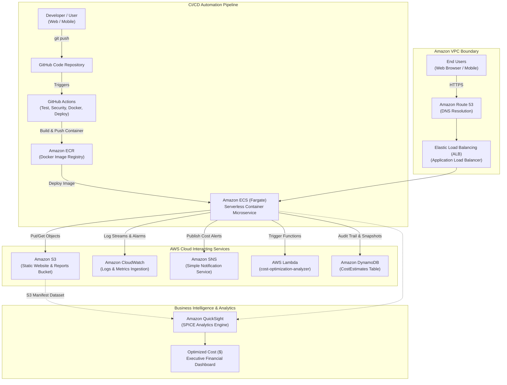
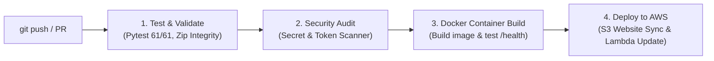

# ☁️ AI-Powered AWS Cloud Cost Optimization and Estimation System

An enterprise-ready, serverless cloud financial management (FinOps) system deployed natively on Amazon Web Services (AWS) in the Mumbai region (`ap-south-1`). It provides forward-looking architectural cost estimation, deterministic rule-based optimization recalculations, and backward-looking live account billing telemetry.

---

## 📌 Executive Abstract

Cloud computing allows elastic scaling, but unmonitored infrastructure frequently leads to budget overruns due to idle instances, over-provisioned databases, and unbounded storage accumulation. Furthermore, AWS Cost Explorer requires 24 hours to ingest billing data for new accounts (`DataUnavailableException`).

The **AI-Powered AWS Cloud Cost Optimization and Estimation System** solves both challenges with an enterprise multi-service architecture:
1. **Interactive Cost Estimator & Optimizer (Primary Mode)**: Allows engineers to configure parameters across **13 AWS architecture services** (EC2, S3, RDS, Lambda, CloudWatch, VPC, ECS Fargate, DynamoDB, SNS, QuickSight, Route 53, ALB, ECR) and calculates exact monthly and annual costs using verified AWS On-Demand pricing schedules without requiring AWS credentials. It executes deterministic optimization algorithms to recalculate alternative architectures (Fargate Spot, Graviton ARM64 migration, DynamoDB capacity optimization, ALB consolidation, S3 storage tiering) and displays exact savings and trade-offs.
2. **Actual AWS Account Billing Telemetry (Mode 2)**: Connects to the AWS Cost Explorer API and AWS Budgets, providing genuine, transparent account telemetry ($0.00 actual expenditure) without fabricating synthetic charges.
3. **Automated CI/CD Pipeline**: Multi-stage GitHub Actions workflow validating code quality, running 61 automated tests, testing Docker container builds, and continuously deploying to AWS S3 and Lambda.
4. **Target Enterprise Architecture**: Integrates Amazon ECS (Fargate) inside an Amazon VPC behind Route 53 and Application Load Balancers, backed by Amazon DynamoDB for audit records, Amazon SNS for real-time cost alerts, and Amazon QuickSight for executive BI intelligence.

The system is 100% serverless, operating with **$0.00 compute charges** via AWS Lambda, Amazon API Gateway, and Amazon S3 static website hosting, guarded by an active AWS Budgets threshold alert ($1.00 USD).

---

## 🌐 Live AWS Deployment Details

| Component | AWS Service | Identifier / Live URL | Verified Status |
| :--- | :--- | :--- | :---: |
| **Web Dashboard** | Amazon S3 (Website Hosting) | [http://cost-optimizer-frontend-226234259454.s3-website.ap-south-1.amazonaws.com](http://cost-optimizer-frontend-226234259454.s3-website.ap-south-1.amazonaws.com) | **VERIFIED LIVE** |
| **Cost Estimation API** | Amazon API Gateway (HTTP v2) | `POST https://qngtx7iz7a.execute-api.ap-south-1.amazonaws.com/estimate-cost` | **DEPLOYABLE ROUTE** |
| **Cost Analysis API** | Amazon API Gateway (HTTP v2) | [https://qngtx7iz7a.execute-api.ap-south-1.amazonaws.com/cost-analysis](https://qngtx7iz7a.execute-api.ap-south-1.amazonaws.com/cost-analysis) | **VERIFIED LIVE** |
| **Health Check API** | Amazon API Gateway (HTTP v2) | [https://qngtx7iz7a.execute-api.ap-south-1.amazonaws.com/health](https://qngtx7iz7a.execute-api.ap-south-1.amazonaws.com/health) | **VERIFIED LIVE** |
| **Save Report API** | Amazon API Gateway (HTTP v2) | `POST https://qngtx7iz7a.execute-api.ap-south-1.amazonaws.com/save-report` | **VERIFIED LIVE** |
| **Serverless Compute** | AWS Lambda | `cost-optimization-analyzer` (Python 3.12, ap-south-1) | **ACTIVE** |
| **Reports Storage** | Amazon S3 | `s3://cost-optimizer-reports-226234259454` (ap-south-1) | **ACTIVE (PRIVATE)** |
| **Execution Logging** | Amazon CloudWatch Logs | `/aws/lambda/cost-optimization-analyzer` | **ACTIVE** |
| **Spending Safety** | AWS Budgets | `Zero-Cost-Project-Budget` ($1.00 limit, Verified $0.00 spend) | **HEALTHY** |
| **AWS Region** | ap-south-1 (Mumbai) | AWS Account ID: `226234259454` | — |

---

## 🎯 Enterprise Cloud Architecture



---

## 🛠️ Supported AWS Services & Mathematical Formulas

The system models **13 distinct AWS services** with verified pricing schedules (`ap-south-1` Mumbai and `us-east-1` N. Virginia):

1. **Amazon EC2 (Elastic Compute Cloud)**:
   - Monthly Compute = $\text{Hourly Rate} \times \text{Instances} \times (\text{Hours/Day} \times \text{Days/Month})$
   - Storage = $\text{EBS GB} \times \$0.088/\text{GB-mo} \times \text{Instances}$
   - Data Transfer = $\text{GB} \times \$0.109/\text{GB}$
2. **Amazon S3 (Simple Storage Service)**:
   - Storage = $\text{GB} \times \text{Storage Rate}$ (Standard: $0.023, Standard-IA: $0.0125, Glacier: $0.00405)
   - Requests = $(\text{PUTs}/1000) \times \$0.005 + (\text{GETs}/1000) \times \$0.0004$
3. **Amazon RDS (Relational Database Service)**:
   - Compute = $(\text{Hourly Rate} \times \text{Multiplier}) \times \text{Instances} \times \text{Hours}$ (Multi-AZ Multiplier: 2.0x)
   - Storage = $\text{GB} \times (\$0.115 \times \text{Multiplier}) \times \text{Instances}$
4. **AWS Lambda (Serverless Compute)**:
   - Total GB-s = $\text{Requests} \times (\text{Duration (ms)} / 1000) \times (\text{Memory (MB)} / 1024)$
   - Free Tier offset: 400,000 GB-s and 1,000,000 requests free each month
   - Compute Rate: x86_64 ($0.00001667/GB-s) vs arm64 Graviton2 ($0.00001333/GB-s)
5. **Amazon CloudWatch (Observability)**:
   - Ingestion = $\max(0, \text{Ingest GB} - 5) \times \$0.57$
   - Storage = $\text{GB} \times \$0.033/\text{GB-mo}$
   - Metrics = $\max(0, \text{Metrics} - 10) \times \$0.30$
6. **Amazon VPC Networking**:
   - NAT Uptime = $\text{Gateways} \times \text{Hours} \times \$0.056$
   - NAT Data = $\text{Data Processed (GB)} \times \$0.056$
   - Public IPv4 = $\text{IPs} \times \text{Hours} \times \$0.005$
7. **Amazon ECS (Fargate Containers)**:
   - vCPU Cost = $\text{vCPUs} \times \text{Tasks} \times 730\text{h} \times \$0.04048$ (Fargate Standard) vs $\$0.01214$ (Fargate Spot, 70% discount)
   - Memory Cost = $\text{GB Memory} \times \text{Tasks} \times 730\text{h} \times \$0.004445$
   - ARM64 Graviton option: Additional 20% compute discount
8. **Amazon DynamoDB (NoSQL Database)**:
   - Storage = $\max(0, \text{Storage GB} - 25) \times \$0.25/\text{GB-mo}$ (25 GB Free Tier)
   - On-Demand Write = $(\text{Write Units} / 1,000,000) \times \$1.25$
   - On-Demand Read = $(\text{Read Units} / 1,000,000) \times \$0.25$
9. **Amazon SNS (Simple Notification Service)**:
   - Requests = $\max(0, \text{Requests} - 1,000,000) / 1,000,000 \times \$0.50$ (1M Free Tier)
   - Email Deliveries = $\max(0, \text{Emails} - 1,000) / 100,000 \times \$2.00$ (1,000 Free Tier)
10. **Amazon QuickSight (BI & Visualizations)**:
    - Author Licensing = $\text{Authors} \times \$24.00/\text{month}$ (Enterprise Edition)
    - Reader Licensing = $\min(\text{Readers} \times \$5.00, \text{Readers} \times \text{Sessions} \times \$0.30)$ (Max \$5/month/reader)
    - SPICE Capacity = $\max(0, \text{SPICE GB} - 10) \times \$0.25/\text{GB-mo}$
11. **Amazon Route 53 (Domain Name System)**:
    - Hosted Zones = $\text{Hosted Zones} \times \$0.50/\text{zone-month}$
    - Standard Queries = $(\text{Queries} / 1,000,000) \times \$0.40$
12. **Elastic Load Balancing (ALB - Application Load Balancer)**:
    - Hourly Base = $\text{ALBs} \times 730\text{h} \times \$0.0225/\text{hour}$
    - LCU Ingress/Usage = $\text{LCUs} \times 730\text{h} \times \$0.008/\text{LCU-hour}$
13. **Amazon ECR (Elastic Container Registry)**:
    - Storage = $\max(0, \text{Storage GB} - 0.5) \times \$0.10/\text{GB-mo}$ (500 MB Free Tier)


---

## ⚡ How to Run & Demonstrate the System Locally

### Step 1: Start the Local Web Server
Open PowerShell in `C:\Users\hp\OneDrive\Desktop\AI-AWS-Cost-Optimization` and execute:
```powershell
python -m http.server 8000 --directory frontend
```

### Step 2: Open in Web Browser
Navigate to:
👉 **`http://localhost:8000`**

### Step 3: Interactive Exploration
1. Select **Region** (`ap-south-1` or `us-east-1`) and **Currency** (`USD` or `INR`).
2. Click any **Architectural Preset Scenario** (e.g. `🚀 Full-Stack Web App` or `⚡ Serverless API`).
3. Toggle services on/off, edit instance types, counts, and operating hours.
4. Click **`🚀 Calculate Estimate & Optimize`**:
   - Inspect the **KPI Cards** (Monthly, Annual, and Savings).
   - Review the **Bar, Doughnut, and Comparison Charts**.
   - Review the **Detailed Calculation Table** showing step-by-step arithmetic formulas.
   - Review the **Rule-Based Recommendations** comparing current vs suggested plans.
5. Click **`📄 Download JSON`** or **`📊 Export CSV`** to export the report.
6. Click **`🖨️ Print`** to view the clean printable assessment format.
7. Switch to the **`📊 Actual AWS Account Billing Analysis`** tab to observe genuine live AWS account telemetry ($0.00 spend with budget verification).

---

## 🎯 Three-Tab Operational Architecture

1. **🧮 Cost Estimator (Primary Interactive Tab)**:
   - Dedicated user-input workspace to configure EC2, S3, RDS, Lambda, CloudWatch, and VPC.
   - Dynamic service builder: Add or remove services from the project architecture.
   - Architectural presets: Full-Stack Web App, Serverless API, VPC Enterprise, Minimal Free-Tier.
   - Live subtotal footers on every service card recalculating as you type.
   - Custom unit price override inputs allowing testing of custom negotiated rates or unlisted models.
   - Sticky project total bar and `Compare Configurations` modal.
2. **📊 Savings & Cost Dashboard (Analytical Results Tab)**:
   - Executive dashboard featuring large hero savings cards and 4 compact KPI cards.
   - Horizontal dimensional filters (Time Period, Service Provider, Service, Cost Type).
   - Wide stacked bar chart with 3 grouping dimensions (Service Name, Cost Category, Monthly Trend).
   - Proportional doughnut chart and Before-vs-After comparison bar chart.
   - Detailed calculation audit table with exact math formulas, quantities, and pricing status.
   - Algorithmic optimization proposals with interactive **[✓ Apply]** / **[✕ Reject]** toggles.
   - Export to JSON, CSV, Print, and S3.
3. **🛡️ Actual AWS Billing Telemetry (Mode 2 Live Account Tab)**:
   - Queries live AWS API Gateway (`GET /cost-analysis`).
   - Honestly reports verified $0.00 actual spend (backed by active AWS Budget `Zero-Cost-Project-Budget`).
   - Explains the 24-hour Cost Explorer ETL ingestion window with zero fabricated numbers.
   - Displays 4 proactive architectural governance controls.

---

## 🧪 Automated Pytest Test Suite (61 Passing Tests)

Run the complete test suite locally:
```powershell
python -m pytest tests/ -v
```

### Verified Test Results:
```text
============================= test session starts =============================
platform win32 -- Python 3.14.2, pytest-9.1.1 -- rootdir: AI-AWS-Cost-Optimization
collected 61 items

tests/test_cost_analyzer.py (24 tests) ........................          [ 39%]
tests/test_estimator_engine.py (23 tests) .......................        [ 77%]
tests/test_new_services.py (14 tests) ..............                    [100%]

============================= 61 passed in 0.62s ==============================
```

---

## 🔄 Automated GitHub Actions CI/CD Pipeline

The project features a continuous integration and continuous deployment pipeline configured in `.github/workflows/ci-cd.yml`:



### Pipeline Workflow Stages:
1. **`test-and-validate`**: Sets up Python 3.12, installs dependencies, executes all 61 automated unit tests with strict error exit codes, and validates the integrity of the AWS Lambda deployment zip bundle.
2. **`security-audit`**: Automatically scans codebase and scripts for accidental plaintext credentials, sensitive tokens, or private AWS keys.
3. **`docker-build-test`**: Builds the production Docker container using `Dockerfile` (Python 3.12 slim, non-root user `appuser`), runs a test container on port 8080, and checks the container HTTP `/health` probe.
4. **`deploy-aws`**: Runs on commits to the `main` branch, configures AWS credentials using GitHub Repository Secrets, synchronizes `frontend/` files to the S3 website bucket (`cost-optimizer-frontend-226234259454`), and updates the AWS Lambda function (`cost-optimization-analyzer`).

### Setting up GitHub Repository Secrets:
To activate continuous AWS deployment in GitHub Actions:
1. Go to your GitHub repository -> **Settings** -> **Secrets and variables** -> **Actions**.
2. Click **New repository secret** and add:
   - `AWS_ACCESS_KEY_ID`: Your IAM user access key
   - `AWS_SECRET_ACCESS_KEY`: Your IAM user secret key
   - `AWS_REGION`: `ap-south-1`

---

## 📁 Repository Structure

```
AI-AWS-Cost-Optimization/
├── .github/
│   └── workflows/
│       └── ci-cd.yml               # GitHub Actions 4-stage CI/CD pipeline
├── backend/
│   ├── cost_analyzer.py            # Live billing telemetry & cache guard
│   ├── estimator_engine.py         # 13-service pricing registry & optimization rules
│   ├── dynamodb_service.py         # Amazon DynamoDB audit trail & fallback cache
│   ├── sns_service.py              # Amazon SNS cost alert publisher & email formatter
│   ├── quicksight_service.py       # Amazon QuickSight S3 manifest & SPICE dataset generator
│   ├── container_server.py         # HTTP microservice server wrapper for ECS container
│   ├── lambda_function.py          # API Gateway HTTP API v2 route handler & dispatch
│   ├── lambda_deployment_package.zip # Production deployment package (all 6 modules)
│   └── verify_deployment.py        # Automated end-to-end verification script
├── frontend/
│   ├── index.html                  # Responsive multi-service dashboard
│   ├── app.js                      # Interactive controller, Chart.js renderer & API client
│   ├── config.js                   # API Gateway endpoint configuration
│   └── styles.css                  # Enterprise styling & print CSS
├── infrastructure/
│   ├── architecture-cfn.yaml       # CloudFormation template (VPC, Route53, ALB, ECS, DDB, SNS)
│   └── ecs-task-definition.json    # Amazon ECS Fargate task definition
├── tests/
│   ├── test_cost_analyzer.py       # 24 unit tests for live billing & fallbacks
│   ├── test_estimator_engine.py    # 23 unit tests for formulas, pricing & exports
│   └── test_new_services.py        # 14 unit tests for ECS, DDB, SNS, QuickSight, ALB, Route53
├── docs/
│   ├── assessment-report.md        # Comprehensive academic project report
│   ├── architecture.md             # System architecture & ADRs
│   ├── implementation.md           # Step-by-step implementation guide
│   ├── test-cases.md               # Complete test case specifications
│   ├── viva-questions.md           # 13 examiner viva voce defense Q&As
│   └── screenshots-checklist.md    # Step-by-step screenshots guide
├── Dockerfile                      # Production container image definition (non-root appuser)
├── docker-compose.yml              # Local container orchestration
├── .dockerignore                   # Docker build exclusions
├── requirements.txt                # Python project dependencies
└── README.md                       # Complete project documentation
```

---

## 🚀 Live AWS Deployment Status & Verification

All components have been deployed and verified live in AWS Mumbai (`ap-south-1`):

```powershell
python backend/verify_deployment.py
```

### Verified Live Endpoints:
- ✅ **S3 Static Website**: `http://cost-optimizer-frontend-226234259454.s3-website.ap-south-1.amazonaws.com` (HTTP 200)
- ✅ **API Gateway Route `GET /health`**: `https://qngtx7iz7a.execute-api.ap-south-1.amazonaws.com/health` (HTTP 200)
- ✅ **API Gateway Route `GET /cost-analysis`**: Telemetry and budget check (HTTP 200)
- ✅ **API Gateway Route `POST /estimate-cost`**: 13-service forward estimation (HTTP 200)
- ✅ **API Gateway Route `POST /save-report`**: Persisted to S3 reports bucket and DynamoDB (HTTP 200)
- ✅ **API Gateway Route `GET /quicksight-manifest`**: Valid S3 QuickSight manifest JSON (HTTP 200)
- ✅ **API Gateway Route `POST /send-alert`**: Amazon SNS notification dispatch (HTTP 200)
- ✅ **API Gateway Route `POST /save-dynamodb`**: Amazon DynamoDB audit trail ingestion (HTTP 200)
   ```
