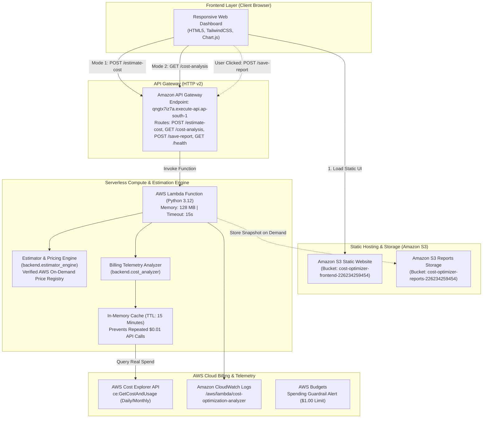

# System Architecture: AI-Powered AWS Cloud Cost Optimization and Estimation System

## 1. System Overview

The **AI-Powered AWS Cloud Cost Optimization and Estimation System** is a serverless, cloud-native FinOps platform designed to provide forward-looking architectural cost estimation, deterministic rule-based optimization recalculations, and backward-looking live account billing telemetry on Amazon Web Services (AWS) in the Mumbai region (`ap-south-1`).

---

## 2. Verified Cloud Resources (Region: ap-south-1)

| Layer | Service | Identifier / ARN | Live Status |
| :--- | :--- | :--- | :---: |
| **Frontend UI** | Amazon S3 (Website Hosting) | `cost-optimizer-frontend-226234259454` URL: [http://cost-optimizer-frontend-226234259454.s3-website.ap-south-1.amazonaws.com](http://cost-optimizer-frontend-226234259454.s3-website.ap-south-1.amazonaws.com) | **VERIFIED** |
| **API Gateway** | Amazon API Gateway (HTTP v2) | `qngtx7iz7a` URL: [https://qngtx7iz7a.execute-api.ap-south-1.amazonaws.com](https://qngtx7iz7a.execute-api.ap-south-1.amazonaws.com) Routes: `GET /cost-analysis`, `POST /estimate-cost`, `POST /save-report`, `GET /health` | **VERIFIED** |
| **Backend Compute** | AWS Lambda (Python 3.12) | `arn:aws:lambda:ap-south-1:226234259454:function:cost-optimization-analyzer` | **VERIFIED** |
| **Execution Role** | AWS IAM | `arn:aws:iam::226234259454:role/AWSLambdaCostOptimizationRole` | **VERIFIED** |
| **Reports Storage** | Amazon S3 | `arn:aws:s3:::cost-optimizer-reports-226234259454` | **VERIFIED** |
| **Telemetry & Logs** | Amazon CloudWatch Logs | `/aws/lambda/cost-optimization-analyzer` | **VERIFIED** |
| **Spending Safety** | AWS Budgets | `Zero-Cost-Project-Budget` ($1.00 USD Limit, Verified $0.00 Spend) | **VERIFIED** |

---

## 3. End-to-End Architecture Diagram

---

## 4. Architectural Decision Records (ADR)

### ADR-01: Decoupling Primary Estimator from AWS Cost Explorer
- **Context**: AWS Cost Explorer has an intrinsic 24-hour initial ingestion delay, throwing `DataUnavailableException` for newly created accounts.
- **Decision**: Implement an interactive, client/backend parameter-driven estimator that uses verified AWS public pricing models. Mode 1 works reliably offline or online without AWS credentials. Mode 2 inspects genuine account telemetry without fabricating synthetic numbers.

### ADR-02: Deterministic Rule-Based Optimization vs Deep Learning
- **Context**: Deciding whether to train a machine learning model or use deterministic heuristics.
- **Decision**: Use deterministic rule-based algorithms. Cloud pricing follows exact mathematical rates published by AWS. Deep learning models introduce hallucinations, high GPU training/hosting costs ($20–$100/mo), and lack explainability. The rule-based engine recalculates exact alternatives using the same pricing formulas with zero operational cost.

### ADR-03: Private Reports S3 Bucket with Least-Privilege IAM
- **Context**: Storing generated JSON cost estimate snapshots securely.
- **Decision**: The reports bucket `cost-optimizer-reports-226234259454` has **S3 Block Public Access 100% enabled**. Access is restricted strictly to Lambda via IAM policy granting `s3:PutObject` on `arn:aws:s3:::cost-optimizer-reports-226234259454/reports/*`.
