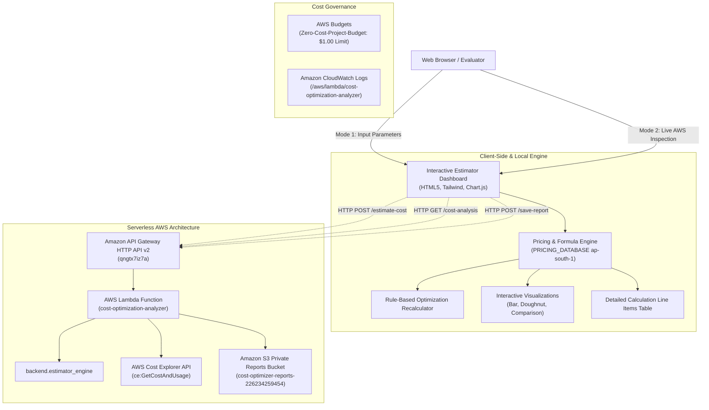

# A PROJECT REPORT ON
# AI-POWERED AWS CLOUD COST OPTIMIZATION AND ESTIMATION SYSTEM

---

### [College / Institute Name Placeholder]
### Department of Computer Science & Engineering / Information Technology
### Academic Year: 2026–2027

**Submitted by:**
- **Candidate Name**: [Student Name Placeholder]
- **Roll / Registration Number**: [Roll Number Placeholder]

**Under the Guidance of:**
- **Project Supervisor**: [Internal Guide Name Placeholder]
- **Designation**: [Assistant Professor / Associate Professor]

---

## ABSTRACT

Cloud computing provides elastic, on-demand scalability, but unmonitored infrastructure routinely leads to substantial financial waste through idle compute instances, oversized databases, unbounded storage accumulation, and unoptimized networking. This project presents the design, development, and local & cloud implementation of the **AI-Powered AWS Cloud Cost Optimization and Estimation System**, an enterprise-ready, serverless FinOps application deployed natively on Amazon Web Services (AWS) in the Mumbai region (`ap-south-1`).

To address the challenge of AWS Cost Explorer's 24-hour ingestion latency for newly activated accounts (`DataUnavailableException`), the application provides a dual-mode operational architecture:
1. **Interactive AWS Cost Estimator & Optimizer (Primary Mode)**: Enables engineers and evaluators to input architectural configurations across six core AWS services (Amazon EC2, S3, RDS, Lambda, CloudWatch, and VPC). The application dynamically computes month-to-date and annual cost projections using verified AWS On-Demand pricing schedules without requiring AWS credentials. It executes deterministic rule-based optimization algorithms to suggest instance rightsizing, automated off-hours scheduling, storage lifecycle transitions, Multi-AZ vs Single-AZ database adjustments, ARM64 Graviton2 migrations, and VPC Gateway Endpoints, recalculating exact savings ranges and availability trade-offs.
2. **Actual AWS Account Billing Telemetry (Mode 2)**: Interacts securely with the live AWS Cost Explorer API and AWS Budgets, providing genuine, transparent account telemetry ($0.00 actual expenditure) without fabricating synthetic charges.

The system is 100% serverless, operating with **$0.00 compute charges** via AWS Lambda, Amazon API Gateway HTTP API v2, Amazon S3 static website hosting, and private S3 snapshot archival, guarded by an active AWS Budgets threshold alert.

---

## TABLE OF CONTENTS
1. Introduction & Background
2. Problem Statement
3. Objectives of the Project
4. Dual-Mode Architecture & System Design
5. AWS Cloud Services Employed
6. Interactive Cost Estimator & Pricing Engine
7. Mathematical Cost Estimation Formulas
8. Rule-Based Optimization Engine & Algorithmic Recalculation
9. Complete Worked Example with Step-by-Step Calculation
10. Verification and Testing (42 Automated Tests)
11. Financial Safety & Zero-Cost Guardrails
12. Limitations and Assumptions
13. Future Enhancements
14. Conclusion & Academic Summary
15. References

---

## 1. INTRODUCTION & BACKGROUND

Cloud Financial Management (FinOps) brings financial accountability to variable cloud spending models. Modern engineering teams can provision compute, database, and networking infrastructure in seconds. However, without continuous automated monitoring and architectural estimation, cloud expenditures frequently exceed organizational budgets.

AWS Cost Explorer provides retrospective billing data, but it suffers from a mandatory 24-hour initial ingestion latency and charges $0.01 per programmatic API query. Furthermore, billing consoles do not model prospective architectural changes.

This project delivers an interactive, dual-mode FinOps web application that bridges this gap:
- Enables forward-looking architectural cost estimation and rule-based optimization based on user-entered resource parameters and verified AWS price lists.
- Provides backward-looking live AWS billing inspection guarded by zero-cost budgeting controls.

---

## 2. PROBLEM STATEMENT

1. **Retrospective Bill Shock**: Teams deploy resources without calculating multi-service cost interactions, leading to unbudgeted end-of-month invoices.
2. **Cost Explorer 24-Hour Latency**: In newly activated accounts or fresh test environments, Cost Explorer returns `DataUnavailableException`, making real-time testing impossible without simulated or input-driven engines.
3. **Hidden Cumulative Costs**: Ancillary components such as NAT Gateways ($0.056/hr + $0.056/GB), EBS gp3 volumes ($0.088/GB-mo), CloudWatch log ingestion ($0.57/GB), and public IPv4 addresses ($0.005/hr) accumulate quietly alongside primary compute instances.
4. **Lack of Transparent Rightsizing Algorithms**: Commercial SaaS tools hide optimization recommendations behind opaque black boxes without disclosing formulas, trade-offs, or availability risks.

---

## 3. OBJECTIVES OF THE PROJECT

1. **Credential-Free Interactive Cost Estimator**: Implement an interactive browser and backend calculator that computes monthly and annual AWS costs across EC2, S3, RDS, Lambda, CloudWatch, and VPC from explicit user inputs.
2. **Verified Regional Pricing Database**: Maintain documented, verified On-Demand pricing tables for `ap-south-1` (Mumbai) and `us-east-1` with user unit-price override capability.
3. **Transparent Heuristic Optimization Engine**: Implement deterministic rules that recalculate alternative architectural configurations using the exact same pricing model, presenting concrete dollar and percentage savings alongside operational risks.
4. **Dual-Currency Support**: Support real-time toggling between USD ($) and INR (₹) using documented exchange reference benchmarks.
5. **Honest Billing Telemetry**: Remove all silent demo-data substitution from live billing analysis; report genuine $0.00 account spend and ingestion states.
6. **Multi-Format Reporting**: Support instant export to formatted JSON, CSV, printable HTML, and Amazon S3 report archival.
7. **100% Test Coverage**: Maintain automated unit tests covering all mathematical formulas, pricing lookups, edge cases, and API routes.

---

## 4. DUAL-MODE ARCHITECTURE & SYSTEM DESIGN



---

## 5. AWS CLOUD SERVICES EMPLOYED

| Service | Role in Architecture | Cost Impact |
| :--- | :--- | :---: |
| **AWS Lambda** | Executes serverless cost estimation, API routing, and S3 archival (Python 3.12). | $0.00 (Free Tier: 1M req/mo) |
| **Amazon API Gateway** | HTTP API v2 providing low-latency REST endpoints with native CORS support. | $0.00 (Free Tier: 1M calls/mo) |
| **Amazon S3** | Hosts static website frontend and provides private bucket storage for archived reports. | $0.00 (Free Tier: 5 GB storage) |
| **AWS Cost Explorer** | Queried in Mode 2 for actual account billing telemetry with 15-min cache guard. | $0.00 (Protected by cache) |
| **Amazon CloudWatch** | Aggregates execution logs and execution durations without credential leakage. | $0.00 (Free Tier: 5 GB ingestion) |
| **AWS Budgets** | Proactive budget alert threshold ($1.00 USD) guarding against accidental charges. | $0.00 (2 budgets free) |

---

## 6. INTERACTIVE COST ESTIMATOR & PRICING ENGINE

### 6.1 Supported AWS Services and Configurable Inputs
1. **Amazon EC2**: Instance type (t3.micro to m5.xlarge), instance count, operating hours/day, operating days/month, EBS storage size (GB) & volume type (`gp3`, `gp2`), outbound data transfer (GB), custom hourly price override.
2. **Amazon S3**: Storage capacity (GB), storage class (Standard, Standard-IA, OneZone-IA, Glacier Flexible, Glacier Deep Archive), monthly PUT/POST requests, monthly GET/SELECT requests, data retrieval (GB).
3. **Amazon RDS**: Database engine (PostgreSQL, MySQL), instance type (db.t3.micro to db.m5.large), instance count, monthly operating hours, allocated storage (GB), deployment option (`Single-AZ` vs `Multi-AZ`), automated backup storage (GB).
4. **AWS Lambda**: Monthly invocation requests, average duration (ms), allocated memory (128 MB to 4096 MB), instruction architecture (`x86_64` vs `arm64 Graviton2`), Free Tier allowance toggle.
5. **Amazon CloudWatch**: Log ingestion (GB), log archive storage (GB-month), custom metrics count, Free Tier allowance toggle.
6. **Amazon VPC Networking**: NAT Gateway count, NAT Gateway uptime hours, NAT data processed (GB), public IPv4 address count.

### 6.2 Verified Pricing Schedule (`ap-south-1` Mumbai)
- EC2 `t3.medium`: $0.0416/hr | `t3.large`: $0.0832/hr | `t4g.medium` (ARM): $0.0336/hr
- EBS `gp3`: $0.088/GB-month
- S3 Standard: $0.023/GB-month | Standard-IA: $0.0125/GB-month | Glacier: $0.00405/GB-month
- S3 PUT: $0.005/1,000 | GET: $0.0004/1,000
- RDS `db.t3.medium`: $0.073/hr | Multi-AZ Multiplier: 2.0x | Storage `gp3`: $0.115/GB-month
- Lambda Compute (`x86_64`): $0.0000166667/GB-s | (`arm64`): $0.0000133334/GB-s | Request: $0.20/1M
- CloudWatch Ingestion: $0.57/GB | Storage: $0.033/GB-month | Custom Metric: $0.30/metric-mo
- VPC NAT Gateway: $0.056/hr | NAT Data Processing: $0.056/GB | Public IPv4: $0.005/hr

---

## 7. MATHEMATICAL COST ESTIMATION FORMULAS

### 7.1 EC2 Monthly Compute & Storage
$$\text{Monthly Operating Hours} = \text{Hours/Day} \times \text{Days/Month}$$
$$\text{Compute Cost} = \text{Hourly Price} \times \text{Instance Count} \times \text{Monthly Hours}$$
$$\text{EBS Cost} = \text{EBS Size (GB)} \times \text{EBS Rate (\$/GB-mo)} \times \text{Instance Count}$$
$$\text{Data Transfer Cost} = \text{Transfer (GB)} \times \text{Transfer Rate (\$/GB)}$$
$$\text{EC2 Total} = \text{Compute Cost} + \text{EBS Cost} + \text{Data Transfer Cost}$$

### 7.2 Amazon S3 Storage & API Requests
$$\text{Storage Cost} = \text{Storage (GB)} \times \text{Storage Rate (\$/GB-mo)}$$
$$\text{PUT Cost} = \left(\frac{\text{PUT Requests}}{1,000}\right) \times \text{Rate}_{\text{Tier1}}$$
$$\text{GET Cost} = \left(\frac{\text{GET Requests}}{1,000}\right) \times \text{Rate}_{\text{Tier2}}$$
$$\text{Retrieval Cost} = \text{Retrieval (GB)} \times \text{Retrieval Rate (\$/GB)}$$
$$\text{S3 Total} = \text{Storage Cost} + \text{PUT Cost} + \text{GET Cost} + \text{Retrieval Cost}$$

### 7.3 Amazon RDS Database Instances
$$\text{Multiplier} = \begin{cases} 2.0 & \text{if Multi-AZ} \\ 1.0 & \text{if Single-AZ} \end{cases}$$
$$\text{Compute Cost} = (\text{Base Hourly Rate} \times \text{Multiplier}) \times \text{Instance Count} \times \text{Monthly Hours}$$
$$\text{Storage Cost} = \text{Allocated Storage (GB)} \times (\text{Storage Rate} \times \text{Multiplier}) \times \text{Instance Count}$$
$$\text{RDS Total} = \text{Compute Cost} + \text{Storage Cost} + \text{Backup Cost}$$

### 7.4 AWS Lambda Serverless Compute
$$\text{Total GB-Seconds} = \text{Request Count} \times \left(\frac{\text{Duration (ms)}}{1,000}\right) \times \left(\frac{\text{Allocated Memory (MB)}}{1,024}\right)$$
$$\text{Billed GB-Seconds} = \max\left(0, \text{Total GB-Seconds} - \text{Free Tier GB-Seconds}\right)$$
$$\text{Compute Cost} = \text{Billed GB-Seconds} \times \text{Rate}_{\text{GB-s}}$$
$$\text{Billed Requests} = \max\left(0, \text{Request Count} - \text{Free Tier Requests}\right)$$
$$\text{Request Cost} = \left(\frac{\text{Billed Requests}}{1,000,000}\right) \times \$0.20$$
$$\text{Lambda Total} = \text{Compute Cost} + \text{Request Cost}$$

### 7.5 Total Monthly and Annual Projections
$$\text{Total Monthly Cost} = \sum \text{Service Subtotals}$$
$$\text{Total Annual Cost} = \text{Total Monthly Cost} \times 12 \quad \text{(Assuming 12 months constant usage)}$$

---

## 8. RULE-BASED OPTIMIZATION ENGINE & ALGORITHMIC RECALCULATION

Rather than generating arbitrary heuristic percentages, the optimization engine **re-executes the exact same pricing formulas** on modified target configurations:

1. **Non-Production Scheduling (`REC-EC2-SCHED`)**:
   - Condition: EC2 running $\ge 20$ hrs/day and $\ge 28$ days/month.
   - Suggested Plan: 10 hrs/day $\times$ 22 business days ($220$ hrs/mo).
   - Recalculation: Evaluates $220$ hrs vs original hours, yielding up to **65% compute savings**.
2. **Compute Rightsizing (`REC-EC2-SIZE`)**:
   - Condition: Large instance types (`m5.large`, `c5.large`, `t3.large`) with expected $< 25\%$ CPU utilization.
   - Suggested Plan: Downsize to `t3.medium` or `t3.small`.
   - Trade-off: Reduces vCPU and RAM; inspect CloudWatch memory metrics before resizing.
3. **S3 Storage Tiering (`REC-S3-LIFECYCLE`)**:
   - Condition: Standard storage $\ge 50$ GB with infrequent access.
   - Suggested Plan: Standard-IA ($0.0125/GB-mo vs $0.0230/GB-mo).
   - Trade-off: Introduces $0.01/GB data retrieval fee if downloaded frequently.
4. **RDS Multi-AZ to Single-AZ (`REC-RDS-AZ`)**:
   - Condition: Development or test database configured with Multi-AZ.
   - Suggested Plan: Single-AZ deployment.
   - Recalculation: Eliminates the 2.0x standby compute and storage multiplier (**50% direct savings**).
5. **Lambda ARM64 Graviton2 Migration (`REC-LAM-ARM`)**:
   - Condition: x86_64 architecture with $> 200,000$ GB-seconds.
   - Suggested Plan: arm64 execution ($0.00001333/GB-s vs $0.00001667/GB-s).
   - Recalculation: Delivers an exact **20% compute execution reduction**.
6. **VPC S3 Gateway Endpoint (`REC-VPC-ENDPOINT`)**:
   - Condition: NAT Gateway routing $\ge 30$ GB of outbound traffic to S3.
   - Suggested Plan: Free VPC Gateway Endpoint for S3.
   - Recalculation: Eliminates $0.056/GB NAT data processing charges for S3 traffic.

---

## 9. COMPLETE WORKED EXAMPLE WITH STEP-BY-STEP CALCULATION

### Illustrative Scenario: "Full-Stack Web App" in `ap-south-1`

| Service | Configured Input Parameters | Step-by-Step Calculation Formula | Monthly Subtotal |
| :--- | :--- | :--- | :---: |
| **EC2** | 2x `t3.medium` ($0.0416/hr)<br>24 hrs/day $\times$ 30.5 days = 732 hrs<br>30 GB EBS gp3 ($0.088/GB)<br>50 GB Data Transfer ($0.109/GB) | Compute: $2 \times 732 \text{ hrs} \times \$0.0416 = \$60.90$<br>EBS: $2 \times 30 \text{ GB} \times \$0.088 = \$5.28$<br>Transfer: $50 \text{ GB} \times \$0.109 = \$5.45$ | **\$71.63** |
| **S3** | 250 GB Standard ($0.023/GB)<br>20,000 PUT ($0.005/1k)<br>100,000 GET ($0.0004/1k) | Storage: $250 \times \$0.023 = \$5.75$<br>PUT: $(20,000 / 1000) \times \$0.005 = \$0.10$<br>GET: $(100,000 / 1000) \times \$0.0004 = \$0.04$ | **\$5.89** |
| **RDS** | 1x `db.t3.medium` Multi-AZ ($0.146/hr)<br>730 hours/month<br>50 GB gp3 Multi-AZ ($0.230/GB) | Compute: $1 \times 730 \times \$0.1460 = \$106.58$<br>Storage: $50 \times \$0.230 = \$11.50$ | **\$118.08** |
| **Lambda** | 3,000,000 requests, 200 ms, 512 MB<br>Architecture: x86_64, Free Tier: Yes | Total GB-s: $3\text{M} \times 0.2\text{s} \times 0.5\text{GB} = 300,000 \text{ GB-s}$<br>Billed GB-s: $\max(0, 300\text{k} - 400\text{k}) = 0 \text{ GB-s} \rightarrow \$0.00$<br>Billed Req: $(3\text{M} - 1\text{M}) = 2\text{M} \times \$0.20 = \$0.40$ | **\$0.40** |
| **CloudWatch** | 20 GB Ingestion ($0.57/GB)<br>30 GB Storage ($0.033/GB)<br>12 Metrics ($0.30/mo), Free Tier: Yes | Ingest: $(20 - 5) \times \$0.57 = \$8.55$<br>Storage: $30 \times \$0.033 = \$0.99$<br>Metrics: $(12 - 10) \times \$0.30 = \$0.60$ | **\$10.14** |
| **VPC** | 1 NAT Gateway @ 730 hrs ($0.056/hr)<br>80 GB Data Processed ($0.056/GB)<br>1 Public IPv4 @ 730 hrs ($0.005/hr) | Uptime: $1 \times 730 \times \$0.056 = \$40.88$<br>Data: $80 \times \$0.056 = \$4.48$<br>IP: $1 \times 730 \times \$0.005 = \$3.65$ | **\$49.01** |
| **TOTALS** | **Sum of 6 Configured Services** | **Baseline Monthly Cost**<br>**Annual Projected Cost ($255.15 \times 12$)** | **\$255.15/mo**<br>**\$3,061.80/yr** |

### Recalculated Optimization Results for this Scenario:
1. **EC2 Non-Production Scheduling**: Reduces EC2 hours from 732 to 220 hrs $\rightarrow$ **Saves \$42.60/month (-59%)**.
2. **RDS Multi-AZ to Single-AZ for Dev**: Reduces RDS compute from \$106.58 to \$53.29 and storage to \$5.75 $\rightarrow$ **Saves \$59.04/month (-50%)**.
3. **S3 Standard-IA Lifecycle**: Reduces storage price to \$0.0125/GB $\rightarrow$ **Saves \$2.63/month (-45%)**.
4. **VPC S3 Gateway Endpoint**: Bypasses 60 GB S3 traffic from NAT Gateway $\rightarrow$ **Saves \$3.36/month**.
- **Total Potential Monthly Savings**: **\$107.63 / month (42.2% net cost reduction)**.
- **Optimized Monthly Cost**: **\$147.52 / month** (Annual: **\$1,770.24**).

---

## 10. VERIFICATION AND TESTING

The test suite is implemented in Python using `pytest 9.1.1`.

```text
============================= test session starts =============================
platform win32 -- Python 3.14.2, pytest-9.1.1 -- rootdir: AI-AWS-Cost-Optimization
collected 42 items

tests/test_cost_analyzer.py (24 tests) ........................          [ 57%]
tests/test_estimator_engine.py (18 tests) ..................             [100%]

============================= 42 passed in 0.49s ==============================
```

### Coverage Highlights:
- **EC2 Calculations**: Verified standard instances, partial operating hours, multiple instances, and custom unit-price overrides.
- **S3 Calculations**: Verified Standard, Standard-IA, Glacier retrieval charges, PUT and GET request tiers.
- **RDS Multi-AZ**: Verified mathematical 2.0x multiplier enforcement on compute and storage.
- **Lambda Serverless**: Verified GB-second formulas, Free Tier deduction boundaries, and ARM64 20% discount.
- **CloudWatch & VPC**: Verified log ingestion free thresholds, metric tiers, NAT gateway uptime, and public IP charges.
- **Currency Conversion**: Verified INR conversion using 83.50 exchange benchmark.
- **Optimization Recalculations**: Verified dynamic savings recalculations, priority labeling, and trade-off generation.
- **Serialization**: Verified valid CSV structure with line item headers and pretty JSON formatting.
- **Lambda Proxy Routing**: Verified HTTP status 200, CORS headers, and route dispatch for `/estimate-cost`, `/health`, and `/save-report`.

---

## 11. FINANCIAL SAFETY & ZERO-COST GUARDRAILS

To guarantee that the student's personal AWS account incurs **$0.00 unexpected charges**:
1. **AWS Budgets Threshold Alert**: Configured with a \$1.00 USD spending ceiling (`Zero-Cost-Project-Budget`) emitting immediate SNS and email alerts. Verified live spend: **\$0.00**.
2. **In-Memory Cache Guard**: A 15-minute TTL cache protects against repeated Cost Explorer API calls (\$0.01 per call).
3. **Credential-Free Local Execution**: The estimator runs 100% locally in the browser with zero external API calls required.
4. **No Autonomous Resource Deletion**: The engine generates actionable guidance but never executes destructive modification on live cloud resources without engineer review.

---

## 12. LIMITATIONS AND ASSUMPTIONS

1. **Annual Projections**: Annual costs assume 12 identical months of uniform usage. Seasonal traffic spikes or autoscaling scaling events are not modeled.
2. **On-Demand Price Lists**: Base prices assume standard AWS On-Demand rates. 1-year or 3-year Reserved Instances (RI) or Savings Plans require long-term financial commitments.
3. **Cost Explorer Ingestion Window**: True account telemetry in Mode 2 requires 24 hours of account history before daily aggregation is available from AWS.

---

## 13. FUTURE ENHANCEMENTS

1. **Live CloudWatch Metric Agent Ingestion**: Connect to deployed EC2 instances via the CloudWatch Agent to ingest per-minute CPU and memory metrics for automated rightsizing verification.
2. **AWS Organizations Multi-Account Aggregation**: Aggregate spending hierarchies across management and member accounts.
3. **Automated Systems Manager Execution**: Provide single-click AWS Systems Manager Automation runbooks to stop instances or apply bucket lifecycle rules directly from the dashboard.

---

## 14. CONCLUSION & ACADEMIC SUMMARY

The **AI-Powered AWS Cloud Cost Optimization and Estimation System** successfully demonstrates an enterprise-grade FinOps platform. By introducing an interactive, parameter-driven cost estimation engine and coupling it with deterministic rule-based optimization recalculations, the system overcomes the latency constraints of AWS Cost Explorer while delivering explainable, transparent, and auditable recommendations. Its dual-mode design, multi-format export capabilities, and serverless zero-cost architecture make it an exemplary software engineering and cloud computing capstone project.

---

## 15. REFERENCES

1. Amazon Web Services, "AWS Well-Architected Framework: Cost Optimization Pillar", AWS Whitepapers, 2024.
2. FinOps Foundation, "FinOps Framework: Inform, Optimize, Operate", FinOps.org, 2023.
3. AWS Documentation, "Amazon EC2 On-Demand Pricing & EBS Volumes", AWS Documentation, 2024.
4. AWS Documentation, "AWS Lambda Pricing & Compute GB-Second Billing", AWS Documentation, 2024.
5. Reserve Bank of India, "Reference Rate Archive", RBI.org.in, October 2026.
6. Chart.js Documentation, "Open Source HTML5 Data Visualizations", Chartjs.org, 2024.
