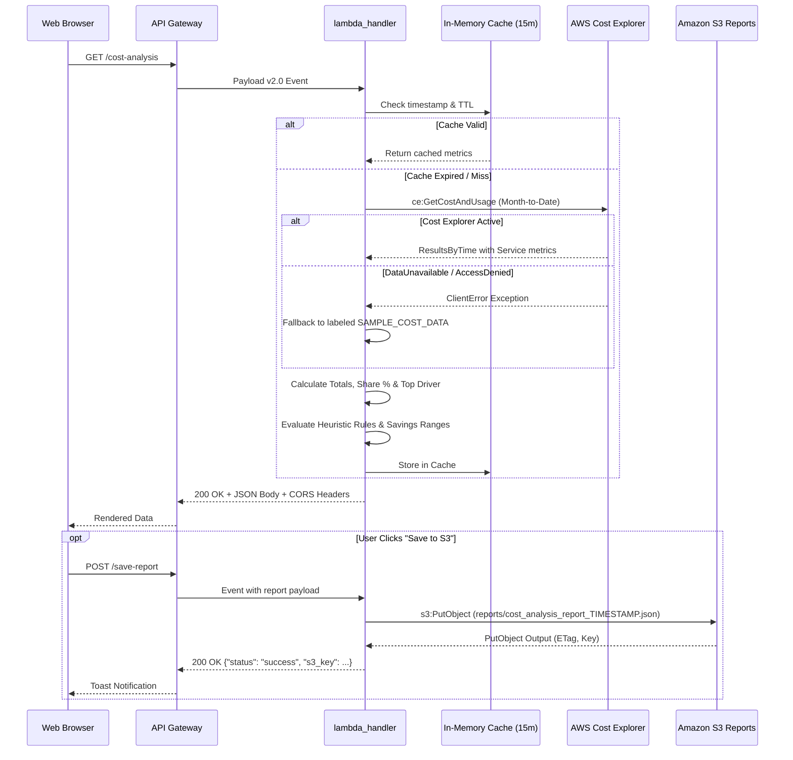

# Step-by-Step Implementation Guide
## AI-Powered AWS Cloud Cost Optimization System

This document provides a comprehensive technical walkthrough of each subsystem implemented in the AI-Powered AWS Cloud Cost Optimization System, covering frontend architecture, API Gateway routing, serverless Lambda compute, AWS Cost Explorer integration, rule-based recommendation logic, S3 report snapshot storage, CloudWatch observability, and AWS Budgets safety guardrails.

---

## 1. Frontend Implementation

### 1.1 Technology Stack
- **HTML5 & Modern DOM API**: Semantic document structure with accessibility standards.
- **Tailwind CSS (CDN)**: Modern utility-first CSS framework providing responsive layouts and dark-mode styling.
- **Chart.js (CDN)**: Interactive canvas-based data visualizations for service spending breakdowns and proportional doughnut charts.
- **Vanilla JavaScript (ES6+)**: Zero runtime framework dependencies (React/Vue/Angular), eliminating heavy build steps and enabling fast static hosting on Amazon S3.

### 1.2 Core Frontend Capabilities
1. **Dynamic Data Source Status Indicator**:
   - Evaluates `data.data_source` and `data.is_sample_data`.
   - Displays an emerald badge (`Live AWS Cost Explorer Data`) when real billing records are returned.
   - Displays an amber badge (`Demo / Sample Data Mode`) with explicit diagnostic messages when Cost Explorer is inactive, uningested, or permissions are restricted.
2. **Retrieval Timestamp Semantics**:
   - Formats `data.retrieval_timestamp_utc` into local time.
   - Explicitly displays `Last Retrieval: <Timestamp> (Sample Data)` or `(Live AWS)`, preventing confusion with the current client clock.
3. **Data Export Options**:
   - **Download JSON Report**: Serializes the full analysis payload along with export metadata (system name, download timestamp, retrieval timestamp, data source mode, region) into a structured JSON file formatted with 2-space indentation.
   - **Export CSV**: Extracts `service_name`, `cost`, and `percentage_of_total` into tabular CSV format for spreadsheet analysis.
4. **User-Triggered S3 Archival**:
   - Provides an explicit "💾 Save to S3" action.
   - Sends a `POST` request to `/save-report` with the active report payload.
   - Displays toast notifications showing the destination S3 bucket and timestamped object key.
5. **Resilient Error & Stale Data Handling**:
   - Catches fetch failures or network timeouts (12-second abort controller).
   - Reveals an error banner with a dedicated "Retry Connection" button.
   - Preserves previously rendered analysis data and activates a warning: `⚠️ Preserving previously retrieved analysis. Data may be stale.`

---

## 2. Amazon API Gateway (HTTP API v2)

### 2.1 Configuration
- **API Name**: `cost-optimizer-api`
- **Protocol**: HTTP (v2.0 payload format)
- **Region**: `ap-south-1` (Mumbai)
- **Endpoint**: `https://qngtx7iz7a.execute-api.ap-south-1.amazonaws.com`
- **Stage**: `$default` with `auto-deploy: true`

### 2.2 Routes and Integrations
| Route Key | HTTP Method | Target Integration | Description |
| :--- | :---: | :--- | :--- |
| `GET /cost-analysis` | GET | `cost-optimization-analyzer` (AWS_PROXY) | Retrieves current cost breakdown and heuristic recommendations. Supports query params `?bypass_cache=true` and `?force_demo=true`. |
| `POST /save-report` | POST | `cost-optimization-analyzer` (AWS_PROXY) | Persists user-requested analysis snapshot to Amazon S3 reports bucket. |
| `GET /health` | GET | `cost-optimization-analyzer` (AWS_PROXY) | Lightweight healthcheck returning status `healthy`. |
| `$default` | ANY | `cost-optimization-analyzer` (AWS_PROXY) | Catch-all fallback route. |

### 2.3 CORS Architecture
HTTP API v2 native CORS is configured to allow browser cross-origin requests:
- **Allowed Origins**: `*`
- **Allowed Methods**: `GET`, `POST`, `OPTIONS`
- **Allowed Headers**: `Content-Type`, `Authorization`
- Additionally, the Python Lambda backend explicitly emits matching `Access-Control-Allow-*` response headers for complete compatibility across environments.

---

## 3. Serverless Backend (AWS Lambda)

### 3.1 Runtime & Environment
- **Function Name**: `cost-optimization-analyzer`
- **Runtime**: Python 3.12 (64-bit x86)
- **Memory**: 128 MB (Cold start peak memory ~88 MB)
- **Execution Timeout**: 15 seconds
- **Handler**: `lambda_function.lambda_handler`

### 3.2 Request Processing Workflow


---

## 4. AWS Cost Explorer Integration

### 4.1 Boto3 Query Construction
The backend initializes the Cost Explorer client in region `us-east-1` (the global AWS billing endpoint):
```python
ce_client = boto3.client("ce", region_name="us-east-1")
response = ce_client.get_cost_and_usage(
    TimePeriod={"Start": start_date_str, "End": end_date_str},
    Granularity="MONTHLY",
    Metrics=["UnblendedCost"],
    GroupBy=[{"Type": "DIMENSION", "Key": "SERVICE"}]
)
```

### 4.2 Date Range Boundary Handling
- Start date: 1st of the current month. If today is the 1st of the month, queries the trailing 30 days.
- End date: Tomorrow's date (`today + timedelta(days=1)`), adhering strictly to AWS Cost Explorer's constraint that `End` must be strictly greater than `Start`.

### 4.3 Error Handling & Fallback Strategy
1. **`DataUnavailableException`**:
   - Occurs on recently activated accounts where AWS billing ingestion has not yet processed its initial 24-hour cycle.
   - Backend catches the exception and serves structured sample data labeled with:
     `"data_source": "demo_data"`, `"is_sample_data": true`.
2. **`AccessDeniedException`**:
   - Occurs when IAM permissions for `ce:GetCostAndUsage` are absent.
   - Caught and documented without breaking the application.
3. **Empty Results / Zero Charges**:
   - Occurs when an active account has zero accumulated charges.
   - Falls back gracefully to sample data with a message stating zero charges have accumulated.

---

## 5. Cost Analysis & Rule-Based Recommendation Engine

### 5.1 Analysis Formulations
- **Total Spend**:
  $$\text{Total Cost} = \sum_{i=1}^{N} \text{Cost}_{\text{Service}_i}$$
- **Service Share**:
  $$\text{Share Percentage}_i = \left( \frac{\text{Cost}_{\text{Service}_i}}{\text{Total Cost}} \right) \times 100$$
- **Highest-Cost Service Driver**:
  $$\text{Top Driver} = \arg\max_{i} (\text{Cost}_{\text{Service}_i})$$

### 5.2 Deterministic Heuristic Rules Matrix
| Target Service | Heuristic Focus | Remediation Logic & Assumptions | Estimated Savings Range |
| :--- | :--- | :--- | :---: |
| **Amazon EC2** | Compute Rightsizing & Scheduling | • Downsize instances averaging < 15% CPU utilization.<br>• Implement off-hours stop/start schedules for non-production environments.<br>• Evaluate 1-year Compute Savings Plans or Spot Instances.<br>*Assumption: CloudWatch metrics must be audited before downsizing.* | 20% – 40% (Midpoint: 30%) |
| **Amazon RDS** | Database Architecture | • Decommission Multi-AZ on development/testing databases.<br>• Terminate idle DB instances with zero connections.<br>• Enable storage auto-scaling instead of over-provisioning.<br>*Assumption: Multi-AZ must remain active on production.* | 15% – 35% (Midpoint: 25%) |
| **Amazon S3** | Storage Lifecycle Policies | • Transition objects older than 30/90 days to Standard-IA / Glacier.<br>• Enable S3 Intelligent-Tiering for variable access data.<br>• Configure 7-day abort rule for incomplete multipart uploads.<br>*Assumption: Historical data is accessed infrequently.* | 15% – 35% (Midpoint: 25%) |
| **CloudWatch** | Telemetry Retention | • Modify log groups from "Never Expire" to 14, 30, or 90 days retention.<br>• Audit high-frequency custom metrics emitting 1-minute datapoints.<br>*Assumption: Retention conforms to auditing compliance.* | 10% – 30% (Midpoint: 20%) |
| **AWS Lambda** | Serverless Optimization | • Power-tune memory allocations to reduce execution duration.<br>• Migrate functions to ARM64 (Graviton2) architecture.<br>*Assumption: Code dependencies support ARM64.* | 5% – 25% (Midpoint: 15%) |
| **Amazon VPC** | Network Architecture | • Release unattached Elastic IPs ($0.005/hr penalty charge).<br>• Deploy free S3 VPC Gateway Endpoints to eliminate NAT data processing fees.<br>*Assumption: Traffic to S3 routes through private subnets.* | 10% – 30% (Midpoint: 20%) |

---

## 6. S3 Report Storage Implementation

### 6.1 Bucket Architecture
- **Bucket**: `cost-optimizer-reports-226234259454` (Region: `ap-south-1`)
- **Access Level**: Private (Public access blocked)
- **Object Key Convention**: `reports/cost_analysis_report_YYYYMMDD_HHMMSS.json`

### 6.2 Security & Least Privilege
- Reports are stored **only when explicitly requested by the user**.
- The Lambda execution role uses a scoped policy allowing `s3:PutObject` strictly on `arn:aws:s3:::cost-optimizer-reports-226234259454/*`.
- Uploaded snapshots are stripped of any credentials or secret access keys.

---

## 7. Observability & Logging (Amazon CloudWatch)

### 7.1 Configuration
- **Log Group**: `/aws/lambda/cost-optimization-analyzer`
- **Format**: Structured JSON log entries containing timestamp, log level, module name, and sanitized transaction messages.

### 7.2 Security Verification
- Logs capture request IDs, date ranges, Cost Explorer response statuses, and execution timings.
- Zero secrets, IAM access keys, or internal token strings are ever written to stdout or CloudWatch.

---

## 8. AWS Budgets Spending Guardrail

### 8.1 Configuration
- **Budget Name**: `Zero-Cost-Project-Budget`
- **Limit**: **$1.00 USD** monthly threshold
- **Verified Spend**: **$0.00 USD**
- **Notification Subscriber**: Configured for actual spend > $0.01 sending alert emails to the student administrator.
